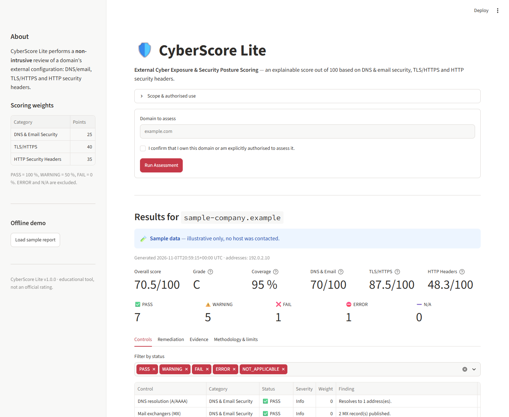
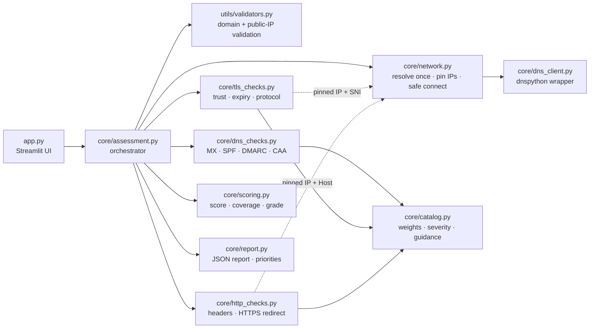
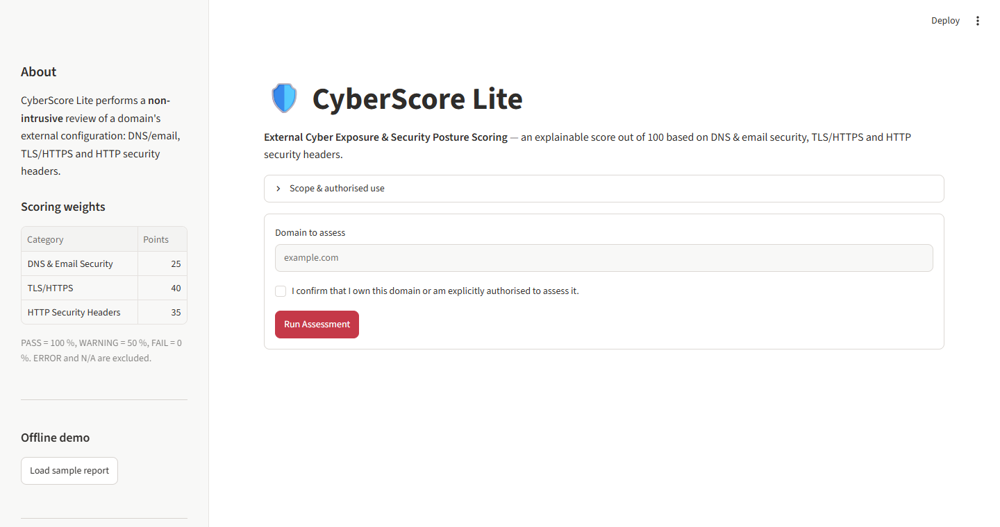
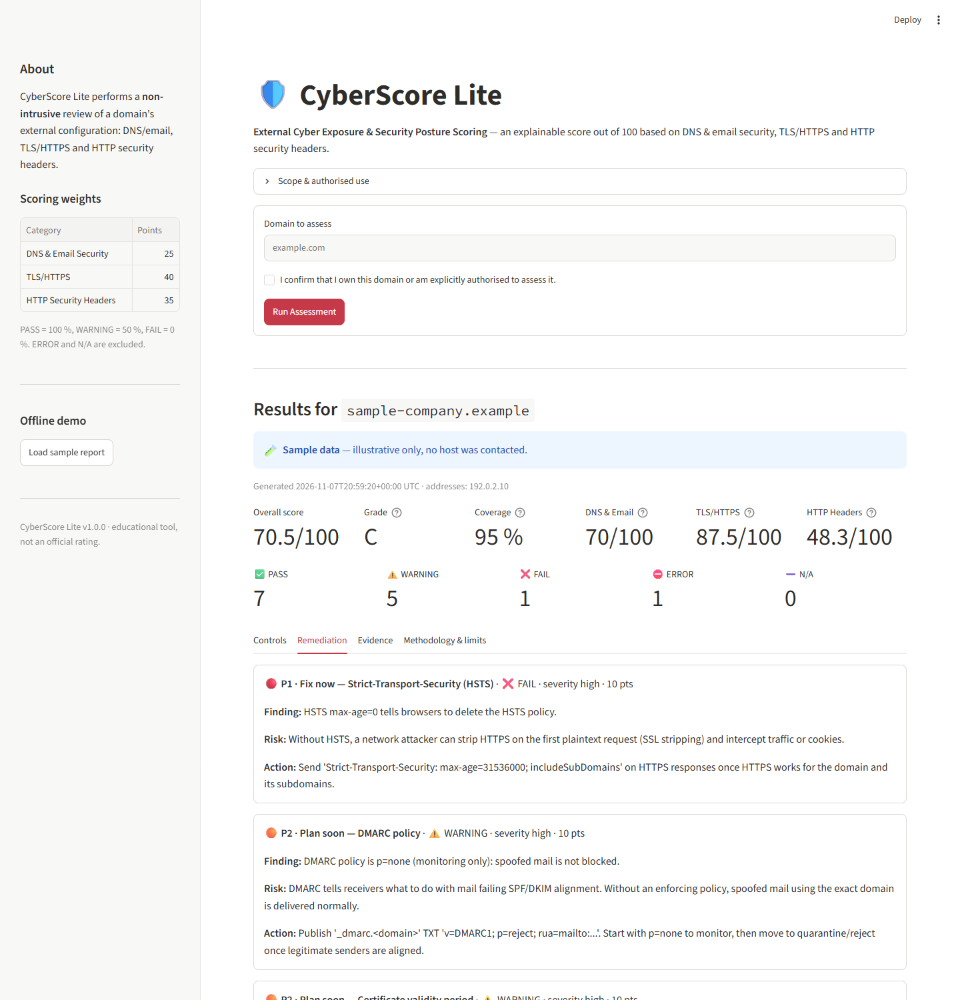

# 🛡️ CyberScore Lite

**External Cyber Exposure & Security Posture Scoring Platform**

[](https://github.com/jee-iyed/CyberScore-Lite/actions/workflows/ci.yml)


CyberScore Lite is a Streamlit web app that runs a **non-intrusive** review of a domain's
externally visible security configuration (DNS & email authentication, TLS/HTTPS and HTTP
security headers) and turns it into an **explainable score out of 100**, with evidence, a
coverage indicator and prioritised remediation advice.

> **Educational tool.** It is not a penetration test, not an exhaustive vulnerability
> scanner and not an official security rating. Only assess domains you own or are
> explicitly authorised to assess.



---

## Table of contents

1. [Project Overview](#1-project-overview)
2. [Features](#2-features)
3. [Architecture](#3-architecture)
4. [Technology Stack](#4-technology-stack)
5. [Installation](#5-installation)
6. [Quick Start](#6-quick-start)
7. [Security Checks](#7-security-checks)
8. [Explainable Scoring Methodology](#8-explainable-scoring-methodology)
9. [Example JSON Output](#9-example-json-output)
10. [Testing](#10-testing)
11. [Security & Authorized Use](#11-security--authorized-use)
12. [Limitations](#12-limitations)
13. [Roadmap](#13-roadmap)

---

## 1. Project Overview

Security teams, auditors and insurers routinely look at a company's *external* posture:
can its domain be spoofed by email, is HTTPS correctly configured, does the website send
basic browser security headers? CyberScore Lite automates these checks for one domain and
answers three questions:

* **What is the posture?** A weighted score /100 per category and overall.
* **How sure are we?** A coverage percentage: controls that could not be assessed
  (network errors) are excluded from the score and *reduce* coverage, instead of being
  silently counted as passed or failed.
* **What should be fixed first?** Each finding comes with the technical evidence, the
  risk, and a concrete action, ranked P1 / P2 / P3.

## 2. Features

* 12 scored security controls across DNS/email, TLS/HTTPS and HTTP headers (+ 2 informational).
* Statuses `PASS`, `WARNING`, `FAIL`, `ERROR`, `NOT_APPLICABLE` with explicit semantics.
* Real parsing instead of substring matching: SPF syntax and lookup count, DMARC tag
  parsing (`p`, `sp`, `pct`), HSTS `max-age` validation, CSP directive analysis,
  `frame-ancestors` vs `X-Frame-Options` precedence, Referrer-Policy fallback lists.
* Explainable scoring: score, grade, coverage, per-category scores and status counts.
* Evidence for every control (records, headers, certificate fields, negotiated protocol).
* Prioritised remediation with risk explanation.
* Downloadable, stable JSON report (`schema_version 1.0`).
* SSRF-aware networking: resolve once, refuse non-public addresses, pin IPs, ports 80/443
  only, same-host redirects only, hard request budget, timeouts everywhere.
* Offline sample report (`?demo=sample` or sidebar button) for demos without network access.
* 290+ pytest tests, including real-socket tests against local loopback "lab" servers.

## 3. Architecture



**Data flow**

1. `validate_domain()` normalises the input (lower-case, punycode) and rejects URLs, paths,
   ports, IP literals and internal/reserved names (`localhost`, `.local`, `.internal`, ...).
2. `network.resolve()` queries A and AAAA **once**. If any address is not globally routable
   the assessment is refused before a single TCP connection is opened.
3. DNS checks query TXT, `_dmarc` TXT, MX and CAA records.
4. TLS and HTTP checks connect **only to the pinned addresses** with SNI / `Host` set to the
   domain, so no new DNS resolution can redirect them (DNS-rebinding mitigation).
5. Every scanner returns homogeneous `CheckResult` objects built from the catalog.
6. `compute_score()` and `build_report()` produce the score and the JSON report.

| Module | Responsibility |
|---|---|
| `app.py` | Streamlit UI: form, authorisation checkbox, progress, dashboard, export |
| `core/assessment.py` | Orchestration and user-facing refusal errors |
| `core/network.py` | Single resolution, public-IP enforcement, pinned connections, port allow-list |
| `core/dns_client.py` | DNS queries that distinguish NXDOMAIN / NoAnswer / timeout / SERVFAIL |
| `core/dns_checks.py` | Resolution, MX, SPF, DMARC, CAA |
| `core/tls_checks.py` | Verified handshake, legacy-protocol probe, certificate evidence |
| `core/http_checks.py` | Header analysis, HTTP→HTTPS redirect, redirect policy, request budget |
| `core/catalog.py` | Single source of truth for weights, severities, descriptions, advice |
| `core/scoring.py` | Weighted score, coverage, grade, counts |
| `core/report.py` | JSON report, prioritised recommendations, limitations |
| `core/config.py` | Timeouts, limits and thresholds |
| `core/sample.py` | Clearly labelled offline sample assessment |
| `utils/validators.py` | Domain validation and `is_public_ip()` |
| `utils/formatting.py` | Pure presentation helpers for the UI |

## 4. Technology Stack

| Component | Choice |
|---|---|
| Language | Python 3.11+ |
| UI | Streamlit |
| DNS | dnspython |
| TLS / X.509 | Python `ssl` (OpenSSL) + `cryptography` for certificate parsing |
| HTTP | Python `http.client` over pinned sockets (no third-party HTTP client) |
| Tests | pytest, Streamlit `AppTest` |
| Lint | Ruff |
| CI | GitHub Actions (Python 3.11 and 3.12) |

## 5. Installation

```bash
git clone https://github.com/jee-iyed/CyberScore-Lite.git
cd CyberScore-Lite
python -m venv .venv
```

Activate the virtual environment:

```powershell
# Windows (PowerShell)
.venv\Scripts\Activate.ps1
```

```bash
# Linux / macOS
source .venv/bin/activate
```

Install dependencies:

```bash
pip install -r requirements-dev.txt   # runtime + pytest + ruff
# or only the runtime: pip install -r requirements.txt
```

## 6. Quick Start

```bash
python -m streamlit run app.py
```

Open http://localhost:8501, enter a domain you are authorised to assess, tick the
authorisation checkbox and click **Run Assessment**. Nothing is sent over the network
until you do.

To explore the dashboard offline, click **Load sample report** in the sidebar or open
http://localhost:8501/?demo=sample. Sample data is illustrative, uses the reserved
`sample-company.example` domain and is flagged `sample_data: true` in the report.

| Home | Remediation (sample data) |
|---|---|
|  |  |

## 7. Security Checks

### DNS & Email Security (25 points)

| Control | Weight | PASS | WARNING | FAIL |
|---|---:|---|---|---|
| SPF record | 10 | one valid record ending `-all`/`~all` | `?all`, no `all`, `ptr` used | missing, multiple records, syntax error, `+all`, > 10 lookups |
| DMARC policy | 10 | `p=quarantine`/`reject`, `pct=100` | `p=none`, `pct<100` | missing, multiple records, invalid `p` |
| CAA record | 5 | `issue`/`issuewild` present | missing, or only `iodef` | — |
| A/AAAA resolution | 0 | informational | | |
| MX / Null MX | 0 | informational (absence ≠ penalty) | | |

* TXT strings split into 255-byte chunks are concatenated before parsing.
* DMARC and CAA discovery climb to parent domains (DMARCbis tree walk, RFC 8659), so a
  subdomain inherits its organisation's policy (`sp` when present).
* A DNS timeout/SERVFAIL gives `ERROR`, never "record missing".
* Domains without MX are **not** penalised for MX; SPF/DMARC still apply because any
  domain can be spoofed in the `From:` header (`v=spf1 -all` + `p=reject` is the
  recommended setup for non-mail domains).

### TLS/HTTPS (40 points)

| Control | Weight | PASS | WARNING | FAIL |
|---|---:|---|---|---|
| Certificate trust & hostname | 15 | chain trusted by the system store, hostname matches | — | untrusted, self-signed, mismatch, expired; port 443 closed |
| Certificate validity period | 10 | > 30 days left | < 30 days left | expired / not yet valid |
| TLS protocol version | 15 | TLS 1.2/1.3 negotiated and TLS 1.0/1.1 refused | — | TLS 1.0/1.1 accepted |

* Only the **verified** handshake (CA + hostname validation) can produce a PASS.
* When verification fails, one diagnostic handshake *without* verification retrieves the
  served certificate **as evidence only** (expiry date, SANs, issuer); the protocol check
  is then `ERROR`, never `PASS`.
* A separate handshake offering only TLS 1.0/1.1 detects deprecated protocol support.
* Network timeouts are `ERROR` (excluded from the score); a refused port 443 is `FAIL`.

### HTTP Security Headers (35 points)

| Control | Weight | PASS | WARNING | FAIL |
|---|---:|---|---|---|
| HSTS | 10 | `max-age` ≥ 6 months | `max-age` < 6 months | missing, `max-age=0`, non-numeric, duplicated directive |
| HTTP → HTTPS redirect | 5 | 3xx to `https://<same host>` | redirect to another host or to HTTP | content served over HTTP (2xx) |
| Content-Security-Policy | 8 | enforced policy restricting scripts | report-only, `unsafe-inline` (without nonce/hash), `unsafe-eval`, wildcard/scheme sources, no `object-src` | missing |
| Clickjacking protection | 5 | `frame-ancestors` restrictive, or XFO `DENY`/`SAMEORIGIN` | `frame-ancestors *` | missing, `ALLOW-FROM`, conflicting/invalid XFO |
| X-Content-Type-Options | 4 | `nosniff` | — | missing / invalid |
| Referrer-Policy | 3 | `no-referrer`, `same-origin`, `strict-origin(-when-cross-origin)` | missing, `origin*`, `no-referrer-when-downgrade` | `unsafe-url` |

* Headers are read from `https://<domain>/` with `HEAD` (falls back to `GET` on 405/501;
  the body is never read). Duplicate headers are preserved and handled per spec.
* Redirects are followed **only** to `https://<same host>` (max 3 hops). Redirects to
  another host are recorded in the evidence but never followed. Port 80 closed →
  `NOT_APPLICABLE` for the redirect check.
* Only security headers are kept as evidence; `Set-Cookie` and bodies are never stored.

## 8. Explainable Scoring Methodology

| Status | Points earned | Counted in evaluable points? |
|---|---:|---|
| PASS | 100 % of weight | yes |
| WARNING | 50 % of weight | yes |
| FAIL | 0 % | yes |
| ERROR | — | no (lowers coverage) |
| NOT_APPLICABLE | — | no (does not lower coverage) |

```
score            = 100 × Σ earned / Σ evaluated weight          (null if nothing evaluated)
coverage         = 100 × Σ evaluated weight / Σ applicable weight
applicable       = 100 − Σ NOT_APPLICABLE weight
category score   = same formula restricted to the category
grade            = A ≥ 90, B ≥ 80, C ≥ 70, D ≥ 60, F — only when coverage ≥ 80 %
```

**Why these weights?** TLS (40) protects every connection and its failures (untrusted
certificate, legacy protocols) are directly exploitable on the network path. HTTP headers
(35) are defence-in-depth for the browser; HSTS weighs most because it prevents SSL
stripping. DNS & email (25) covers domain spoofing (SPF + DMARC carry 20 of the 25 points).
Inside each category, severity drives weight.

**Methodological safeguards**

* A score is never presented without its coverage. If coverage is below 80 %, the UI
  shows an explicit warning and **no grade** is given; e.g. a domain where only DNS could
  be assessed may score 100 with 25 % coverage, and is flagged as unreliable.
* Informational controls (A/AAAA, MX) have weight 0 and never change the score.
* Weights are validated at import time (`validate_catalog()`) and by tests.

## 9. Example JSON Output

Excerpt of the report produced by the offline sample (`sample_data: true`):

```json
{
  "schema_version": "1.0",
  "tool": { "name": "CyberScore Lite", "version": "1.0.0" },
  "assessment": {
    "domain": "sample-company.example",
    "generated_at_utc": "2026-11-07T20:59:42+00:00",
    "resolved_addresses": ["192.0.2.10"],
    "sample_data": true,
    "method": "non-intrusive (DNS queries, TLS handshakes, HTTP HEAD/GET on / only)"
  },
  "summary": {
    "score": 70.5,
    "grade": "C",
    "reliable": true,
    "coverage_percent": 95.0,
    "categories": {
      "dns":  { "label": "DNS & Email Security",  "max_points": 25.0, "earned_points": 17.5, "score": 70.0, "coverage_percent": 100.0 },
      "tls":  { "label": "TLS/HTTPS",             "max_points": 40.0, "earned_points": 35.0, "score": 87.5, "coverage_percent": 100.0 },
      "http": { "label": "HTTP Security Headers", "max_points": 35.0, "earned_points": 14.5, "score": 48.3, "coverage_percent": 85.7 }
    },
    "counts": { "PASS": 7, "WARNING": 5, "FAIL": 1, "ERROR": 1, "NOT_APPLICABLE": 0 }
  },
  "checks": [
    {
      "id": "http_hsts",
      "name": "Strict-Transport-Security (HSTS)",
      "category": "http",
      "status": "FAIL",
      "severity": "high",
      "weight": 10.0,
      "summary": "HSTS max-age=0 tells browsers to delete the HSTS policy.",
      "evidence": { "sample_data": true, "max_age": 0 },
      "description": "HSTS is sent over HTTPS with max-age of at least 6 months.",
      "risk_explanation": "Without HSTS, a network attacker can strip HTTPS on the first plaintext request (SSL stripping) and intercept traffic or cookies.",
      "recommendation": "Send 'Strict-Transport-Security: max-age=31536000; includeSubDomains' on HTTPS responses once HTTPS works for the domain and its subdomains."
    }
  ],
  "recommendations": [
    { "priority": "P1", "check_id": "http_hsts", "status": "FAIL", "severity": "high", "finding": "HSTS max-age=0 tells browsers to delete the HSTS policy.", "...": "..." }
  ],
  "not_assessed": [
    { "check_id": "http_https_redirect", "name": "HTTP to HTTPS redirect", "reason": "Plain HTTP endpoint could not be assessed." }
  ],
  "limitations": ["Non-intrusive, point-in-time assessment ...", "..."],
  "disclaimer": "Generated by CyberScore Lite for an authorised, non-intrusive assessment. ..."
}
```

## 10. Testing

```bash
python -m pytest -v
ruff check .
```

The suite (295 tests) never touches the Internet:

| File | Focus |
|---|---|
| `test_validators.py` | valid/malformed domains, IDN, URL/port/path rejection, private, loopback, link-local, CGNAT, metadata IP, IPv6 ULA, IPv4-mapped / 6to4 / NAT64 / Teredo bypasses |
| `test_network.py` | resolve-once, mixed public/private refusal, NXDOMAIN vs no address vs timeout, port allow-list, pinned-IP connections |
| `test_dns.py` | NXDOMAIN/NoAnswer/timeout/SERVFAIL classification, split TXT strings, SPF variants (multiple, `+all`, syntax, 10-lookup limit, redirect), DMARC `p=none`/`reject`/`pct`/`sp` regression, MX, CAA tree walk |
| `test_tls.py` | valid / expired / untrusted / mismatched certificates, handshake errors, legacy protocol detection, **real TLS handshakes against loopback lab servers** (self-signed, expired, TLS 1.0-enabled) |
| `test_http.py` | HSTS (missing, `max-age=0`, invalid), CSP strength, frame protection, nosniff, Referrer-Policy, redirects (same host, external refused, loops, budget), HEAD→GET fallback, **real HTTP lab servers** (duplicate headers, malformed responses, external redirect never contacted) |
| `test_scoring.py` | PASS/WARNING/FAIL/ERROR/N/A maths, partial coverage, null score, grades, catalog consistency |
| `test_report.py` | valid JSON, required fields, priority ordering, evidence passthrough, sample flag |
| `test_assessment.py` | end-to-end orchestration with mocked network, refusal before any connection |
| `test_app.py` | Streamlit `AppTest`: no scan on load, authorisation required, invalid input, dashboard rendering, cooldown, sample mode |

*Lab tests*: the loopback servers run on `127.0.0.1`; the public-IP guard is relaxed only
inside those tests via monkeypatching, so production code never allows loopback.

## 11. Security & Authorized Use

**Only assess domains you own or have written permission to assess.** The UI requires an
explicit authorisation confirmation for each run.

Protections implemented (and covered by tests):

* **Input**: bare domain names only — no scheme, path, port, credentials or IP literal;
  internal/reserved suffixes refused.
* **SSRF**: every resolved address must be globally routable (private, loopback,
  link-local, CGNAT, multicast, reserved, documentation, and IPv6 transition formats that
  embed such IPv4 addresses are refused). A single non-public address blocks the run.
* **DNS rebinding**: resolution happens once; TLS/HTTP connect to the pinned IPs only.
* **Redirects**: only `https://<same host>` is followed; other destinations are never
  contacted.
* **Footprint**: ports 80/443 only, ≤ 3 TLS handshakes, ≤ 8 HTTP requests (HEAD first,
  body never read), 5 s connect / 8 s read timeouts, 15 s cooldown between runs in the UI.
* **Never weakening TLS to get a PASS**: certificate validation is always on for scoring.
* **Data minimisation**: no cookies, bodies or credentials are stored; only security
  headers, public DNS records and public certificate fields appear in evidence.
* **No offensive features**: no port scanning, brute force, fuzzing or exploitation.

Residual risks: the protections reduce but do not mathematically eliminate SSRF risk if
the app is exposed publicly (e.g. a shared host's own public IP, or egress controls of the
hosting network). For a public deployment add authentication, rate limiting per client
and network egress filtering.

## 12. Limitations

* Point-in-time, single-endpoint view (`https://<domain>/`, `http://<domain>/`); other
  subdomains, paths and ports are out of scope.
* When several A/AAAA records exist, the first reachable address is assessed.
* TLS: cipher suites, key size, OCSP stapling and Certificate Transparency are not
  graded.
* SPF includes are not expanded recursively (the 10-lookup check counts top-level terms
  only); DKIM is not checked (selectors are unknown); DNSSEC is not checked.
* CSP analysis is heuristic (inspired by common CSP evaluators), not a full CSP parser.
* Weights are a documented, opinionated model, not an industry standard.

## 13. Roadmap

* **High**: DNSSEC and MTA-STS / TLS-RPT checks; recursive SPF lookup counting; cipher
  suite grading; per-client rate limiting for public deployments.
* **Medium**: scan history (SQLite) and score trends; PDF export; assessment of `www.`
  and other user-declared hosts; Dockerfile.
* **Low**: dark-mode report theme; multi-language UI; badge generation.

---

*Built as a portfolio project to demonstrate secure-by-design Python, network security
fundamentals and explainable risk scoring.*
